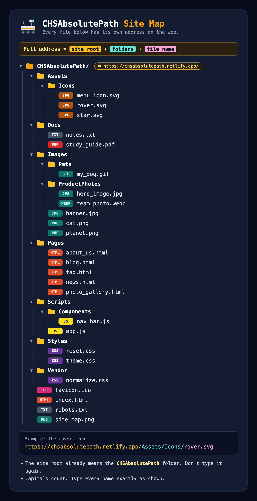

# CHSAbsolutePath

A practice website for learning **absolute paths** (full web addresses).

Students build a web page in VS Code on their own computer. That page can't reach these files with a short path like `Images/cat.png`, because the files aren't on the student's computer. They're on the internet. So students have to write each file's full address:

```html

```

The site comes with a site map, styled like the file trees in the [Route 404](https://pathroute404.lovable.app) game, so students can see where every file lives.



## How it works

The `CHSAbsolutePath/` folder is the website. On Netlify, that folder becomes the site root, `https://chsabsolutepath.netlify.app/`. The home page shows the site map.

Every address follows one rule:

| Site root | + Folders | + File name |
| --- | --- | --- |
| `https://chsabsolutepath.netlify.app/` | `Assets/Icons/` | `rover.svg` |

Route 404 teaches **relative** paths, which start from the file you're writing in. This site teaches **absolute** paths, which start from the root of a website and work from any page, anywhere.

## What's on the site

Every file shows students something visible when their address is right.

| File | Practice with | What students see when it works |
| --- | --- | --- |
| `Images/…` (PNG, JPG, GIF, WebP) | `` | The picture, labeled with its own path. `my_dog.gif` is animated. |
| `Assets/Icons/…` (SVG) | `` | A star, a rover or a menu icon |
| `Styles/theme.css` | `<link rel="stylesheet">` | The page turns space-dark, plus a "✓ theme.css loaded" badge |
| `Styles/reset.css`, `Vendor/normalize.css` | `<link rel="stylesheet">` | A "✓ loaded" badge in the corner |
| `Scripts/app.js` | `<script src>` | An "app.js loaded" message, and a rover drives across the screen |
| `Scripts/Components/nav_bar.js` | `<script src>` | A menu bar with links to every page in `Pages/` |
| `Pages/…` (HTML) | `<a href>` | A "You made it to…" page that shows its full address |
| `Docs/study_guide.pdf`, `Docs/notes.txt` | `<a href>` | The file opens in the browser. The study guide covers absolute paths. |
| `favicon.ico` | `<link rel="icon">` | A star in the browser tab |
| `robots.txt` | The address bar | A short note about what robots.txt is for |

<details>
<summary>Full folder list</summary>

```
CHSAbsolutePath/
├── Assets/
│   └── Icons/
│       ├── menu_icon.svg
│       ├── rover.svg
│       └── star.svg
├── Docs/
│   ├── notes.txt
│   └── study_guide.pdf
├── Images/
│   ├── Pets/
│   │   └── my_dog.gif
│   ├── ProductPhotos/
│   │   ├── hero_image.jpg
│   │   └── team_photo.webp
│   ├── banner.jpg
│   ├── cat.png
│   └── planet.png
├── Pages/
│   ├── about_us.html
│   ├── blog.html
│   ├── faq.html
│   ├── news.html
│   └── photo_gallery.html
├── Scripts/
│   ├── Components/
│   │   └── nav_bar.js
│   └── app.js
├── Styles/
│   ├── reset.css
│   └── theme.css
├── Vendor/
│   └── normalize.css
├── favicon.ico
├── index.html
├── robots.txt
└── site_map.png
```

</details>

## Tips for class

- **Never type the folder name in the address.** The site root already means the `CHSAbsolutePath` folder, so `…netlify.app/CHSAbsolutePath/Images/cat.png` won't work.
- **Match capitals exactly.** Folders start with a capital letter (`Images`). Files are lowercase with underscores (`hero_image.jpg`).
- **Test an address by pasting it into the browser's address bar.** If the file opens there, the address is right.
- Students' pages can be opened straight from VS Code or through Live Server. Either way, students need to be online while they work.
- Before the lesson, open the site on a student device to make sure the school's web filter allows `netlify.app`.

## Publishing on Netlify

**Option 1: drag and drop.** Log in to Netlify, go to [app.netlify.com/drop](https://app.netlify.com/drop) and drag the inner `CHSAbsolutePath` folder onto the page.

**Option 2: deploy from this GitHub repo.** In Netlify, import this repository and use these settings:

- **Publish directory:** `CHSAbsolutePath`
- **Build command:** leave it blank

> [!IMPORTANT]
> Set the publish directory. If Netlify publishes the whole repository, every address gains an extra `/CHSAbsolutePath/` and the site map will be wrong.

With either option, go to **Site configuration → Change site name** and enter `chsabsolutepath`.

## Rebuilding the generated files

`build_site.py` draws the pictures and writes the study guide PDF, the pages in `Pages/`, `index.html` and `site_map.png`. Run it again if you add, rename or remove files, or if the site's address changes:

```sh
python3 build_site.py
```

- To change the address, edit `DOMAIN` near the top of the script. Then update the address in `Docs/notes.txt` by hand.
- The site map is built from the files actually in the folder, so it always matches what you publish.
- The script needs Python 3, the Pillow library (`pip3 install pillow`) and Google Chrome. The path to Chrome is set for a Mac.
- The CSS and JS files, `star.svg`, `menu_icon.svg`, `notes.txt` and `robots.txt` are written by hand. The script never changes them.

## Repository layout

| Path | What it is |
| --- | --- |
| `CHSAbsolutePath/` | The website. This is the only folder that gets published. |
| `build_site.py` | Rebuilds the generated files (see above) |
| `README.md` | This file |
